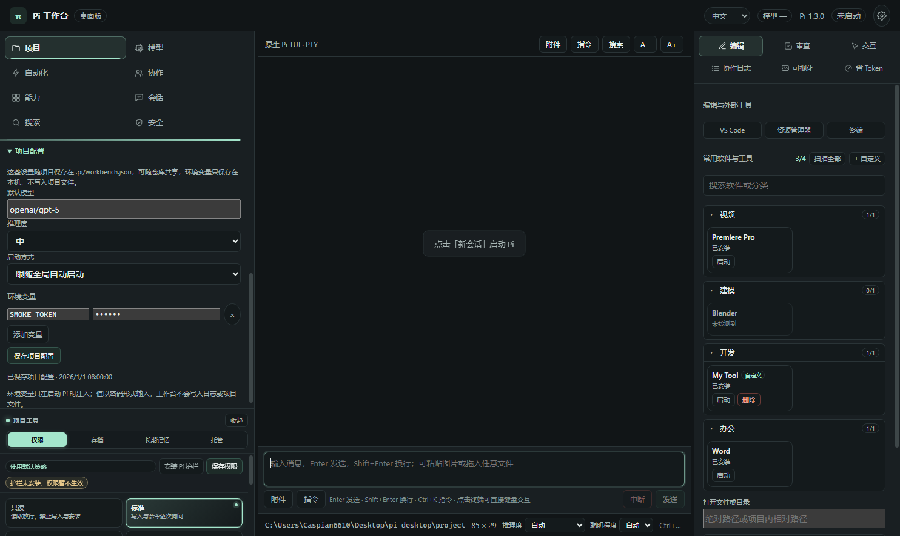

# pi--desktop

极简的 Pi 操作台，保留原生态。

已确认方向：打开后使用真正的 Pi TUI，旁边提供图形辅助，并按当前项目和任务在授权范围内自主选择/调用 Skills 与 MCP；不以模拟终端输出代替真实执行。文档入口：`doc/README.md`，实现蓝图：`doc/design-blueprint.md`，开发交接：`doc/development-handoff.md`。



## 下载与安装

Windows 安装包与免安装版见仓库 Releases：

- `Pi-Workbench-<版本>-setup.exe`：安装版，可选择安装目录并创建桌面快捷方式
- `Pi-Workbench-<版本>-portable.exe`：免安装，双击即用
- macOS（dmg / zip）与 Linux（AppImage / deb）由 GitHub Actions 构建

首次打开：

1. 左侧「项目」页显示 Node / npm / Pi 检测结果；缺少 Pi 时点「一键配置环境」，只安装 Pi，不改动既有配置。
2. 点「选择项目目录」，或用参数启动：`"Pi 工作台.exe" --project D:\work\repo`。项目页还会扫描 VS Code / Cursor / TRAE 等编辑器的最近项目，支持一键导入。
3. 首次安装或配置完成后会自动生成桌面快捷方式；如被误删，可在右上角齿轮 →「快捷方式」补建。再次双击同一快捷方式会复用当前窗口并切换项目。
4. 勾选「打开时自动启动 Pi」后，下次启动恢复上次项目并自动接入终端。

真实模型调用只会在终端里由 Pi 发起；工作台不读取、不回显密钥。

## 已实现

- 左侧 8 项导航：项目 / 模型 / 自动化 / 协作 / 能力 / 会话 / 搜索 / 安全；设置收进右上角齿轮浮层。
- Electron + node-pty + xterm.js：真实 Pi TUI、中文输入、窗口缩放、WebGL 渲染与输出合批。
- 多项目会话树：同时运行多个项目，按项目展开、切换与新建会话。
- 项目权限：预设与逐项规则、自动同意、路径例外、全局护栏；凭据外传、破坏性命令与系统目录始终拦截。
- 项目配置与应用默认值：项目页可设置模型、推理度、启动方式与本机环境变量；设置页定义新项目默认值。优先级为本次启动 > 项目配置 > 应用默认值，密钥只存本机。
- 模型厂商分组（国内 / 国外 / 免费）、按任务类型强偏好与总控自动选模、模型一键切换。
- 多 Agent 协作：自动组队、主管规划与并行执行结构可视化。
- 能力包按项目真实开关，Skill / MCP 管理与市场、任务状态、VS Code 联动。
- 联网搜索；抓取支持自动（搜索结果为种子）与指定网页两种模式；逆向分析接入 radare2 只读 triage。
- 安全页：代码审计（Semgrep / Trivy / gitleaks，SARIF/JSON 导出）、授权渗透（被动基线 + 经授权的 Nuclei 主动扫描）、带哈希链的审计日志。
- 预置设计与安全 Skills，随包安装到用户级 Pi 技能目录，不覆盖用户自建同名 Skill。
- 项目存档、本机长期记忆与习惯画像，更新检查与一键环境。
- 自然语言指令路由、全类型附件、中英文界面。
- 启动恢复上次项目、单实例切换项目、桌面快捷方式。
- electron-builder 打包（NSIS / portable）与三平台 CI。

## 文档

先读 [文档索引](doc/README.md)，再读 [开发交接包](doc/development-handoff.md) 和 [主蓝图](doc/design-blueprint.md)。候选项目、源码链接及许可范围集中在 [来源登记](doc/sources.md)。

任务点智能路由见 [任务点智能路由](doc/task-routing-design.md)：依据项目任务点自动选择模型，并联合选用 Skills/MCP；先满足质量、安全与隐私约束，再优化总时间/费用。该模块已有设计，尚未实现与实测。

## 打开原型

直接用浏览器打开 `prototype/index.html`。支持中转站连接元数据填写、模型待应用选择、配置导出、命令暂存、专注模式与辅助面板切换。
模型面板支持编辑和确认移除中转站；编辑移除了已选模型时会清空待应用选择。支持粘贴本原型导出的 JSON 草稿重新导入，最多 20 个中转站；导入只追加，重复标识整批拒绝。只接受环境变量密钥引用和基础字段，高级 Pi 配置不会被静默截断。取消编辑不修改原数据，所有配置仍仅存本次页面内存。
原型不运行 Pi、不联网、不收集真实 API Key，刷新即清空。完整边界见 `doc/prototype-design.md`。

## 开发验证

诊断与原型测试需要 Node.js 22 或更新版本，无需 npm install。在项目根目录执行：

```sh
node --test utils/doctor.test.mjs
node --test utils/model-config.test.mjs
node utils/doctor.mjs
python utils/verify-prototype.py
```

诊断退出码：0 表示所列基础检查通过，不代表 Pi 启动成功；1 表示检查发现前置条件缺失；2 表示诊断自身未完成。
脚本只发现 PATH 候选文件，不执行候选，不读取凭据，不安装依赖。端口探测仅短暂绑定 IPv4 回环后释放。

桌面端开发：

```sh
cd project
npm install
npm run verify   # 类型检查 + i18n 校验 + 构建
npm start        # 开发运行
npm run dist:win # 打包 Windows 安装版与免安装版
```

自动化验证：`npm run smoke` 覆盖 PTY 链路；`.smoke/i18n-smoke.mjs` 覆盖界面与中英文切换；
`.smoke/workbench-smoke.mjs` 覆盖工作台主流程（需先构建）。

配置存放：项目级设置写入项目内 `.pi/workbench.json`，可随仓库共享且不含密钥；项目环境变量只写本机
`userData/project-env.json`。应用级默认值写本机 `userData/app-defaults.json`。
启动参数优先级为：本次启动显式选择 > 项目配置 > 应用默认值。

## 目录

- `project`：可运行的 Electron 桌面工作台。
- `doc`：调研与设计蓝图。
- `prototype`：交互原型。
- `database`：当前不使用数据库，无数据库账号或密码。
- `utils`：环境诊断及测试。

浏览器测试使用已有 Python Playwright 和 Chromium；缺失时须先配置测试环境。截图保存到 `prototype/desktop-preview.png` 与 `prototype/mobile-preview.png`。

## 安全边界

不自动安装全局 Pi，不修改现有认证配置，不进行付费模型调用。

安全能力仅用于自有或已获书面授权的目标：

- 主动扫描必须在应用内逐次确认授权，票据一次性、30 分钟有效；不支持 CIDR 网段、通配符、目标列表、私网（除非显式开启本机目标）与云元数据地址。
- Nuclei 使用固定参数与限速，任务可随时停止，每次扫描写入带哈希链的审计日志。
- 未随包分发任何第三方二进制；外部工具由用户确认后安装，支持卸载与手动路径。
- 抓取遵循 robots.txt 与限速，不绕过登录、验证码或反爬机制。
